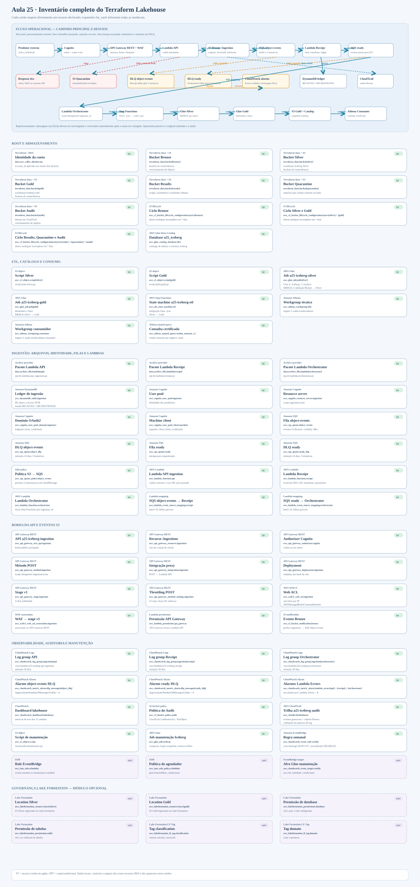

# Aula 25 — Lakehouse na AWS: Iceberg, ACID, esquema estrela e time travel

**Projeto independente para AWS Academy Learner Lab**, inspirado no repositório [cloud-aula-24](https://github.com/iuresf/cloud-aula-24) (mesma filosofia: Terraform, quatro buckets, Bronze → Glue Silver → Glue Gold → Athena, Step Functions sob demanda, evidências e limpeza). Não depende do deploy da Aula 24.

## Objetivo e perguntas

Empresa de e-commerce recebe ERP (pedidos e itens), cadastro (clientes/produtos), gateway de pagamentos e eventos web. O negócio deseja analisar receita por **tempo, cliente, produto, canal e região**, além de reconstruir estornos e corrigir indicadores sem publicar arquivos parcialmente atualizados.

**Perguntas avaliativas**:

1. Por que um conjunto de Parquets no Data Lake não basta para `MERGE`, atomicidade e time travel sem gestão adicional?
2. Qual a receita atual por **ano/mês, região, categoria e canal**? Qual o **grão** da fato de vendas?
3. O que aconteceu com o pedido **P1042** entre a aprovação e o estorno? Consulte (a) a história dos eventos em Silver e (b) o estado anterior da fato Gold usando snapshot Iceberg.
4. Uma falha de validação na Silver pode deixar um meio-commit publicado? Execute `fail-demo` e investigue.
5. Uma reentrega do `lote_002` duplica receita ou eventos? Execute `replay`.
6. A execução terminou Silver, mas falhou Gold: existe ACID entre duas tabelas? **Não.** Como o consumidor deve decidir quando consultar as saídas?
7. Por que sessões e itens de pedidos não devem ser somados depois de um JOIN direto? Use outra fato de sessões.
8. Qual o papel de cada arquivo `metadata/*.metadata.json`, manifest list `.avro`, manifests `.avro` e `data/*.parquet`?

## Arquitetura e responsabilidade



A figura identifica os recursos Terraform do lakehouse e da ingestão corporativa. O módulo Lake Formation continua opcional, pois a `LabRole` do Learner Lab não tem autorização para suas APIs. `LabRole`, arquivos locais e artefatos criados durante a execução estão marcados separadamente. Os ícones são do [pacote oficial de arquitetura da AWS](https://aws.amazon.com/architecture/icons/). Para atualizar o SVG após uma mudança na infraestrutura, execute `python3 figuras/gerar_fluxo.py`.

```
ERP/Cadastros/Gateway/Eventos
         |  runner.py: upload + manifesto sha256/VersionId
         v
Bronze S3 (CSV/JSONL originais e versionamento de objetos)
         |
         v
Step Functions -> job SILVER (deduplica, valida, MERGE em Iceberg v2)
         |        pedidos, itens, clientes, produtos, pagamentos,
         |        historico_pagamentos, eventos
         v
Step Functions -> job GOLD (5 dimensões, fato_itens_venda, fato_sessoes)
         |        Iceberg v2: commits e snapshots POR TABELA
         v
Athena engine 3 / Glue Data Catalog -> SQL atual + FOR VERSION AS OF
```

- **S3** guarda os bytes; **Glue** transforma; **Iceberg** gerencia estrutura, snapshots e commits; **Glue Catalog** aponta para `metadata_location`; **Athena** consulta; **Lake Formation** é governança opcional, sujeita ao ambiente.
- **Bronze não é Iceberg**. Seus objetos são preservados pelo S3 e rastreados via um manifesto operacional JSON em `results/manifestos/bronze/`.
- **Silver e Gold são tabelas Iceberg independentes**, fisicamente com subpastas `data/` e `metadata/` (padrão físico pode variar pelo engine). Table Metadata é JSON; manifest list e manifests são Avro no Iceberg v2; dados são Parquet neste projeto.
- O `results/manifestos/silver/` e `results/manifestos/gold/` contém **manifestos operacionais em JSON** para rastrear fontes/`metadata_location` e ligar Silver a Gold por `run_id`; esses JSONs **não são** os manifests Avro internos do Iceberg.
- O manifesto Bronze de cada envio é passado à Step Functions. Silver confere `VersionId` e SHA-256 dos objetos enviados antes de processar, grava `origem_arquivo` em suas linhas e aponta para esse manifesto. Cada linha Gold tem `etl_run_id` e origens: as dimensões derivadas guardam os arquivos agregados, a fato de vendas guarda arquivos de pedido, item, cliente, produto e pagamento, e a fato de sessões guarda os eventos. O manifesto Gold aponta para o Silver do mesmo `run_id`.
- **Atomicidade apenas por tabela**. Atualizar 5 dimensões e fato não é transação global. Para consumo consistente do conjunto, execute queries após `Step Functions SUCCEEDED` e, em produção, implemente publicação controlada de uma versão de produto de dados.
- O versionamento S3 do Bronze **não é** o time travel de Iceberg; snapshots antigos dependem de retenção e expiração.

## Grão e modelo estrela

- `fato_itens_venda`: **uma linha por `item_id`**; pedido P1042 tem dois itens. Medidas: `quantidade`, `valor_bruto`, `receita_liquida`. No estorno, os dois itens permanecem, mas a receita zera.
- `dim_tempo`: `sk_tempo=yyyymmdd`, data, ano, mês.
- `dim_cliente`: cliente e estado.
- `dim_produto`: produto e categoria.
- `dim_canal`: site/app.
- `dim_regiao`: Nordeste/Sudeste.
- `fato_sessoes`: **uma sessão, data e canal**; evita multiplicar visitas pelo número de itens comprados.
- O ETL valida chaves, mas o Iceberg **não impõe FK** automaticamente.
- `historico_pagamentos` preserva eventos do negócio mesmo após a expiração eventual de snapshots.

## Pré-requisitos

- Conta e região AWS Academy com serviços Glue, S3, Athena e Glue Catalog acessíveis. Permissões e serviços variam entre laboratórios: **não há garantia de que todos os recursos sejam liberados**.
- `LabRole` existente confiável para `glue.amazonaws.com`, com S3, Glue, CloudWatch, catálogo e permissões de Lake Formation quando governado. A identidade que roda Terraform precisa de `iam:PassRole`. No AWS Academy, as Lambdas também usam essa role, pois o laboratório bloqueia `iam:CreateRole`; em uma conta corporativa, preencha `ingestion_role_arn` com uma role dedicada de menor privilégio. Quando a manutenção é habilitada, o módulo cria a role limitada do agendador EventBridge.
- AWS CLI autenticado (credenciais temporárias), Terraform 1.5+, Python 3.10+, `jq`, `boto3`, Bash.
- Provider AWS fixado em **5.44.0**, conforme workaround da Aula 24: buckets criados por AWS CLI para evitar a leitura de Object Lock bloqueada em alguns Learner Labs.
- Glue **4.0** por padrão (Iceberg v2); Athena **engine 3**. O custo de DPU/Worker é real enquanto jobs executam.

## Módulos Terraform

`storage` cria Bronze, Silver, Gold, Results, Quarantine e Audit. `catalog` cria o database Glue; `etl` publica os dois jobs; `orchestration` usa Step Functions com integração síncrona aos jobs; `query` cria o workgroup técnico Athena. `ingestion` cria Cognito, API Gateway, WAF, três Lambdas, duas filas SQS com DLQs e um ledger DynamoDB; `observability` cria logs, alarmes, dashboard e CloudTrail; `maintenance` publica o job de manutenção Iceberg e sua regra semanal, inicialmente desligada; `consumption` cria o workgroup Athena de consumidores e a consulta certificada `vendas_mensais_v1`. `governance` registra Silver/Gold no Lake Formation e cria LF-Tags quando habilitado.

## Ingestão corporativa

```text
Cognito (OAuth2 client_credentials) → API Gateway REST + WAF → Lambda API
                                                        └→ URL S3 pré-assinada
Produtor ─────────────────────────────────────────────────→ S3 Bronze/ingestion/
S3 ObjectCreated → SQS object-events → Lambda receipt → Results/manifesto + DynamoDB ledger
                                                 │
                                                 └→ Quarantine se contrato/hash falhar
SQS ready → Lambda orchestrator → Step Functions → Glue Silver → Glue Gold
             └→ DLQ em falhas repetidas de cada fila
```

1. O cliente obtém um token OAuth2 no Cognito usando `client_credentials` e chama `POST /ingestions` com `file_name`, `content_type`, `source_system`, `schema_version`, `size_bytes` e SHA-256.
2. A Lambda API valida o contrato, inclusive tamanho positivo até 100 MiB, cria o `ingestion_id` e devolve uma URL pré-assinada válida por 15 minutos. Erros de contrato retornam `400 / VALIDATION_ERROR`; indisponibilidade ao assinar a URL retorna `503 / PRESIGN_UNAVAILABLE`. O arquivo não atravessa a API ou Lambda.
3. O upload no prefixo `ingestion/` gera um evento S3 na fila. A Lambda `receipt` calcula novamente o SHA-256, valida metadados, grava o manifesto Bronze e registra `bucket/chave/VersionId` no DynamoDB.
4. O evento pronto segue à segunda fila. A Lambda `orchestrator` inicia a Step Functions com nome derivado do `ingestion_id`; reentregas não iniciam outra execução com o mesmo nome.
5. Falhas de contrato na chegada, incluindo metadados ausentes, tamanho divergente ou hash divergente, copiam o original para `Quarantine`, registram `REJECTED` e a razão no ledger e confirmam a mensagem. Falhas operacionais de S3, DynamoDB ou SQS são reenviadas pela SQS e seguem para a DLQ após cinco tentativas. A Lambda `orchestrator` registra `ORCHESTRATION_RETRY` no ledger antes de devolver uma falha transitória à fila `ready`. Alarmes observam DLQs e erros de Lambda.
6. Na Step Functions, Silver e Gold tentam novamente até três vezes para erros transitórios do Glue e timeout, com espera exponencial de 15 s. Qualquer erro restante é capturado: uma falha Silver encerra a execução como `FAILED` sem iniciar Gold; uma falha Gold encerra como `FAILED`, preservando o snapshot Iceberg já publicado por Silver. O alarme `ExecutionsFailed` registra essas execuções no CloudWatch.

O cliente usa todos os cabeçalhos devolvidos pela API, inclusive `x-amz-checksum-sha256`; assim o S3 verifica o checksum durante o upload e a Lambda `receipt` o recalcula sobre o objeto versionado. O contrato de entrada é deliberadamente mínimo: para executar um refresh dimensional completo, envie o conjunto de datasets esperado pelo job Silver usando o fluxo de lote da aplicação produtora. O `runner.py` continua sendo o caminho de carga demonstrativa da aula.

O `runner.py` continua existindo como caminho didático/local. Para produção, a API substitui o upload direto feito pelo runner.

### Operação e retenção

- O CloudTrail grava eventos de gerenciamento e de objetos Bronze no bucket Audit, com validação de integridade dos logs.
- Cada Lambda tem log group com 30 dias; o dashboard mostra erros das Lambdas e alarmes são criados quando houver mensagens em DLQ.
- O job `a25-iceberg-iceberg-maintenance` compacta os fatos e expira snapshots mais antigos que 90 dias. A regra EventBridge semanal nasce `DISABLED`; habilite `enable_iceberg_maintenance=true` somente depois de aprovar a retenção de time travel.
- O workgroup `a25-iceberg-consumer` separa consultas de consumo das consultas técnicas; `vendas_mensais_v1` é a consulta certificada inicial. A autorização de consumidores deve ser concedida pelo Lake Formation em uma conta que permita LF-Tags.

## Implantação passo a passo

```bash
aws sts get-caller-identity
aws iam get-role --role-name LabRole --query 'Role.Arn' --output text
python3 -m venv .venv
source .venv/bin/activate
pip install -r requirements.txt
cp terraform/terraform.tfvars.example terraform/terraform.tfvars
# Edite ARN, região e prefixo exclusivo; não cole credenciais no arquivo.
cd terraform
terraform init
terraform fmt -check
terraform validate
terraform plan -out=aula25.tfplan
terraform apply aula25.tfplan
terraform output
cd ..
```

Verifique no console: buckets `bronze/silver/gold/results`; database Glue; jobs `-silver`, `-gold`; máquina de estados Step Functions; workgroup Athena.

## Execução guiada

```bash
python runner.py initial     # carrega inicial, Step Functions Silver -> Gold, valida R$ 249,70
python runner.py snapshots   # guarda IDs reais dos snapshots
python runner.py delta       # estorna P1042, aprova P1045, valida R$ 198,80
python runner.py replay      # reenviar delta: mesmas 5 linhas e R$ 198,80
python runner.py fail-demo   # pagamento inválido: falha antes dos commits da Silver
python runner.py verify      # valida integridade da tabela de fatos
python runner.py trace-gold  # confere cada linha Gold até VersionId e SHA-256 do Bronze
python runner.py questions   # executa perguntas, inclusive time travel
```

No Athena, selecione o **database** do `terraform output database` e o **workgroup** do `terraform output workgroup`; execute os arquivos em `sql/` (um statement por vez). Para time travel, descubra `snapshot_id` REAL na tabela `"fato_itens_venda$snapshots"` e substitua o placeholder **somente depois do delta**. A consulta histórica revela a receita dos itens do P1042 no snapshot inicial, desde que ele não tenha sido expirado.
Use também `sql/06_rastreabilidade.sql` para localizar, por `item_id`, os arquivos Bronze que compõem a linha Gold. O `etl_run_id` liga a linha aos manifestos Gold e Silver; o `VersionId` e SHA-256 ficam no manifesto Silver. `runner.py trace-gold` confere os arquivos e hashes das sete tabelas Gold.

### Resultados esperados (total da Gold)

| Etapa | P1042 | P1044 | P1045 | Total | Itens da fato | Eventos históricos de pagamento |
|---|---:|---:|---:|---:|---:|---:|
| initial | 129,90 | 119,80 | 0,00 | **249,70** | 5 | 4 |
| delta | 0,00 | 119,80 | 79,00 | **198,80** | 5 | 6 |
| replay | 0,00 | 119,80 | 79,00 | **198,80** | 5 | 6 |

Importante: MERGE idempotente garante o **estado lógico** da tabela; reexecuções ainda podem registrar novos snapshots, dependendo do motor. Time travel observa estado de tabela, e histórico de pagamentos observa eventos de negócio.

## Onde observar metadados

```
s3://BUCKET_BRONZE/pagamentos/lote_002.jsonl  (VersionId de objeto S3)
s3://BUCKET_SILVER/pagamentos/data/*.parquet
s3://BUCKET_SILVER/pagamentos/metadata/*.metadata.json
s3://BUCKET_SILVER/pagamentos/metadata/*-m0.avro / snap-*.avro (nomes ilustrativos)
s3://BUCKET_GOLD/fato_itens_venda/data/*.parquet
s3://BUCKET_GOLD/fato_itens_venda/metadata/*.metadata.json / *.avro
s3://BUCKET_RESULTS/manifestos/bronze/*.json
s3://BUCKET_RESULTS/manifestos/silver/*.json
s3://BUCKET_RESULTS/manifestos/gold/*.json
```

Use console S3 para observar arquivos, Glue Catalog para observar `metadata_location`, e Athena `"pagamentos$snapshots"`, `"fato_itens_venda$snapshots"` para observar histórico. **Não edite ou apague manualmente arquivos Iceberg em `data/` e `metadata/`.**

## Falhas e limites didáticos

- Falha no job Silver **antes de publicar**: arquivos preparatórios não devem mudar o snapshot atual da tabela. O cenário `fail-demo` insere um pagamento inválido, espera falha controlada e remove a chave (um delete marker, se Bronze versionada). A Step Functions aplica as retentativas transitórias e então encerra em `FalhaSilver`, sem executar Gold. Verifique a execução, `$.error` e os snapshots depois.
- Falha Gold **após** alguns commits: tabelas dimensionais podem ter versões distintas. Não prometa atomicidade global.
- `replay` reenvia bytes e ganha uma nova versão de objeto Bronze; o Iceberg no entanto mantém linhas de negócio sem duplicação por chave. Separar rastreabilidade física de idempotência lógica.
- Reprocessamento lê todos os arquivos da Bronze (incrementalidade **lógica** por MERGE, não CDC incremental de leitura). Em produção prefira bookmarks, manifestos por lote, validação de eventos e compactação planejada.
- Partição Iceberg da fato usa `months(data_pedido)` (transformação de partição **oculta**), não `ano=.../mes=...` manual; já o Bronze preserva os caminhos de origem. Não confunda a semântica de partição das camadas.
- `MERGE` de tabelas pode reescrever arquivos Parquet (copy-on-write); não é atualização física in-place de um registro.
- Lake Formation está no módulo opcional `terraform/modules/governance`. Nesta conta, `lakeformation:GetDataLakeSettings` e `ListResources` retornaram AccessDenied; o laboratório usa permissões Glue/IAM sem registrar os buckets no Lake Formation. Em outra conta, habilite `enable_lake_formation=true` após conceder permissões de administrador LF à identidade de deploy.

## Limpeza e controle de custos

```bash
python runner.py cleanup
cd terraform
terraform plan -destroy -out=destroy.tfplan
terraform show -no-color destroy.tfplan
terraform apply destroy.tfplan
```

O script destrói todos os buckets próprios, incluindo versões S3 da Bronze; use apenas em ambiente isolado. Caso o `destroy` falhe por job em andamento, pare a execução e repita após seu término.

## Fonte de referência

Projeto adaptado de `https://github.com/iuresf/cloud-aula-24`. Os conceitos de Spark Iceberg e Athena seguem:
- https://docs.aws.amazon.com/glue/latest/dg/aws-glue-programming-etl-format-iceberg.html
- https://docs.aws.amazon.com/athena/latest/ug/querying-iceberg-time-travel-and-version-travel-queries.html
- https://iceberg.apache.org/spec/
